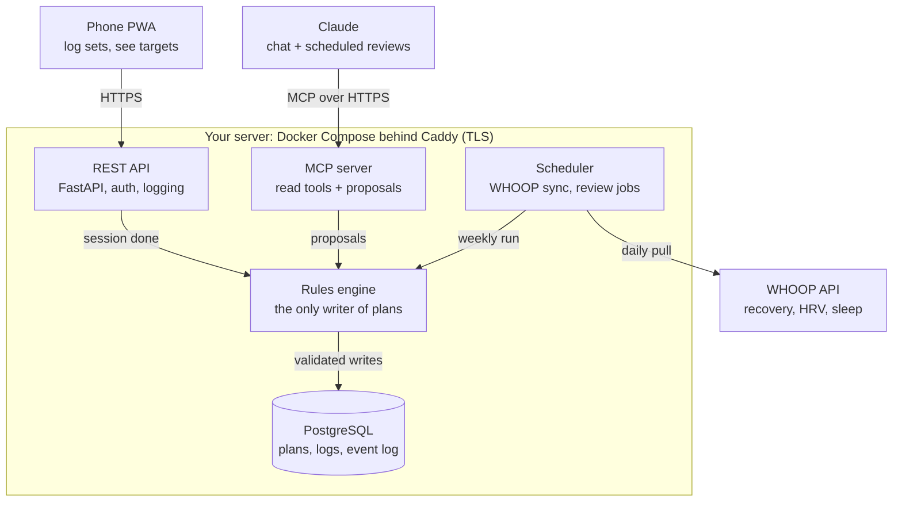

# Hypertrophy Coach — Technical Spec

Oct 28, 2026 · Temurbek Khujaev

## Overview

A single-user hypertrophy coach, self-hosted, that replaces RP Hypertrophy for Temur: it plans mesocycles, prescribes each session's load, reps, RIR and sets, logs performance, and adapts. A deterministic rules engine owns every prescription; Claude reviews data, explains, and proposes changes that pass the same engine.

**Scope (v1):** one user, one gym, one active mesocycle; web logging UI (phone-first PWA); REST API; MCP server for Claude; scheduled review jobs; WHOOP and bodyweight inputs.

**Out of scope (v1):** multi-user, social features, nutrition logging beyond bodyweight, exercise video library, native apps.

**Design principles**

1. Every rule traces to a cited finding or is marked as a heuristic with its confidence.
2. Load progresses on performance, not on the calendar. Reps above the target range force a load change.
3. Subjective feedback (soreness, pump, joint pain) and objective data (rep and load trend, e1RM, readiness) both drive volume; neither alone.
4. Hard safety constraints (disc caps, no singles on axial lifts) cannot be overridden by the engine, Claude, or a manual edit without an explicit flag.
5. Logging a set costs at most two taps when the prescription is met.

## User profile and constraints

All user-specific values live in one versioned config file (`profile.yaml`) loaded at startup; the engine reads it, Claude can propose edits to it, and every edit is logged.

```yaml
athlete:
  name: Temur
  height_cm: 189
  bodyweight_kg: 84          # overwritten by weekly average
  training_age: detrained_intermediate
  goal: hypertrophy
  phase: lean_bulk
  target_gain_kg_per_week: [0.2, 0.5]

schedule:
  timezone: Asia/Qatar
  wake: "02:00"
  bed: "17:35"
  training_days: [THU, FRI, SAT, MON, TUE]
  cardio_days: [SUN, WED]       # zone 2, 40-45 min
  session_cap_min: 65
  drop_order_if_short: [legs]   # first session dropped when a day is lost

priorities:                     # current meso
  priority: [chest, side_delts, back]
  maintenance: [quads, hamstrings, glutes, calves]
  never_last_in_session: [side_delts, chest, back]

safety:
  lumbar_disc: L4               # asymptomatic ~2 years
  axial_lifts: [barbell_squat, trap_bar_deadlift]
  axial_rir_floor: 1            # RIR never below 1 on axial lifts
  axial_min_reps: 5             # no singles, no low-rep testing
  stop_signals: [leg_pain, radiating_pain, numbness]
  squat_setup: heels_elevated_2.5_5kg

equipment:
  dumbbell_step_kg: 2           # verify actual rack steps
  barbell_step_kg: 2.5
  cable_stack_step_kg: 4.5
  cable_addon_kg: [1.25, 2.5]   # magnetic add-ons, if owned
  machines: [chest_supported_row, cable_crossover, lat_pulldown,
             assisted_pullup_dip, hammer_incline_press, reverse_flye,
             diverging_row, seated_leg_curl, lying_leg_curl,
             standing_calf_raise, leg_press, trap_bar]
  unavailable: [lateral_raise_machine]
  disliked: [cable_rope_crunch, hanging_knee_raise]  # grip-limited
```

**Open:** dumbbell rack step size and whether add-on plates exist determine the load ladder (§ Algorithms, load progression). Leg extension and hack squat availability are unknown.

## Training model

The engine encodes the rules below. Confidence: **High** = consistent meta-analytic support; **Moderate** = meta-analysis with wide uncertainty or a few good trials; **Heuristic** = practitioner consensus or engineering choice, tunable.

| Parameter | Engine rule | Evidence | Confidence |
| --- | --- | --- | --- |
| Weekly volume | Hard sets per muscle per week: priority 10–12 start, ramp toward 16–20; maintenance 4–6. Indirect sets count 0.5. | More sets → more growth with diminishing returns (Schoenfeld 2017; Pelland 2024); fractional counting from Pelland 2024 | High (direction), Moderate (exact numbers) |
| Frequency | Each priority muscle ≥ 2 sessions/week; split sets when > ~10 per session | 2×/week ≥ 1×; little extra benefit beyond that at equal volume (Schoenfeld 2016; Pelland 2024) | High |
| Proximity to failure | Working sets at 0–3 RIR; weekly ramp 3 → 2 → 1 → 0–1. Axial lifts floored at 1 RIR. | Growth rises as sets get closer to failure; training to absolute failure adds little (Refalo 2023; Robinson 2024) | High |
| Rep range | 5–30 reps all valid; default compounds 6–10, machines 8–12, isolation 10–20 | Similar hypertrophy across loads when sets are taken near failure (Schoenfeld 2021) | High |
| Progression | Double progression: add reps within range, then the smallest load step once all sets hit the top. Rep-only progression allowed when the load step is > 10%. | Load and rep progression give similar hypertrophy (Plotkin 2022) | Moderate |
| RIR accuracy | Calibration sets to failure on isolation lifts in week 1 and every 2nd week; per-exercise bias correction | RIR predictions are less accurate far from failure and at high reps (Halperin 2022) | Moderate |
| Muscle length | Prefer exercises loading the stretched position (incline curl, overhead triceps, seated leg curl, deep DB press) | Lengthened-position training grows more in several trials (Maeo 2021; Maeo 2023; Wolf 2023) | Moderate |
| Rest intervals | Compounds 2–3 min, isolation 1.5–2 min; timer default, not enforced | Longer rests (> 60–90 s) slightly favour growth (Singer 2024) | Moderate |
| Deload | 1 week after 4–6 accumulation weeks, or triggered early; sets −50%, load −10%, RIR 3–4 | Practitioner consensus (Bell 2023); a 1-week deload doesn't add growth and may cost a little strength (Coleman 2024) | Heuristic |
| Volume autoregulation | Add or remove sets per muscle from performance trend + feedback + readiness (§ Algorithms) | RP-style MEV→MRV model; individual volume response varies widely | Heuristic |
| Protein | 1.6–2.2 g/kg/day; engine flags weekly average below 1.6 | Gains plateau around 1.6 g/kg (Morton 2018) | High |
| Energy surplus | Bodyweight +0.2–0.5 kg/week (≈0.25–0.5% BW); flag outside band for 2 weeks | Lean-bulk guidance (Iraki 2019) | Moderate |
| Sleep | Readiness modifier only; one short night never changes the plan | One night of sleep loss lowers muscle protein synthesis ~18% (Lamon 2021) | Moderate |
| HRV / recovery score | Advisory: lowers that day's RIR target or volume only after 3+ consecutive low days | HRV-guided programming evidence comes mostly from endurance training | Heuristic |

## Data model

PostgreSQL. Prescriptions and logs are separate rows, so every deviation between plan and performance is queryable. All engine and Claude changes are append-only events.

| Table | Key columns | Notes |
| --- | --- | --- |
| `exercise` | id, name, rp_name, equipment, pattern, is_axial, lengthened_bias, rep_range_default, load_step_kg | `rp_name` keeps RP's naming for import/export |
| `exercise_muscle` | exercise_id, muscle, fraction | 1.0 direct, 0.5 indirect (bench → triceps 0.5) |
| `load_ladder` | equipment, loads_kg[] | Available loads per equipment, incl. add-ons (cable 4.5, 5.75, 7, 9 …) |
| `mesocycle` | id, name, start_date, weeks, priority_muscles[], status, rir_schedule[] | One `active` at a time |
| `session_template` | meso_id, day_index, weekday, name | Push A, Pull A … |
| `slot` | template_id, order, exercise_id, rep_min, rep_max, start_sets, is_priority | Exercise position within a day |
| `planned_set` | session_id, slot_id, set_no, load_kg, reps_target, rir_target, is_calibration | Written by the engine before each session |
| `session` | id, meso_id, week, day_index, date, status (planned / done / partial / skipped / moved) | |
| `logged_set` | planned_set_id, load_kg, reps, rir_reported, completed_at, note | One row per performed set |
| `feedback` | session_id, muscle, soreness (0–3), pump (0–3), workload (0–3), joint_pain (0–3), performance_self (0–3) | Asked after the last set for that muscle |
| `readiness` | date, recovery_pct, hrv_ms, rhr_bpm, sleep_h, sleep_consistency_pct, source | WHOOP sync or manual |
| `bodyweight` | date, kg | Daily morning weigh-in; engine uses 7-day mean |
| `body_scan` | date, method, weight_kg, lean_kg, fat_pct | BIA/DEXA, trend only |
| `estimate` | exercise_id, date, e1rm_kg, best_set, rir_bias | Recomputed after each session |
| `event` | ts, actor (engine / claude / user), type, payload_json, rationale | Audit log: every prescription change and why |

Indexes: `logged_set(planned_set_id)`, `session(meso_id, week, day_index)`, `readiness(date)`, `estimate(exercise_id, date desc)`.

## Algorithms

All functions are pure: inputs are DB rows plus `profile.yaml`, outputs are `planned_set` rows and `event` records. They run after each logged session and before each planned one.

### 1. Load progression (per slot, per session)

Double progression with forced load changes. This is the main fix over RP, which kept 6 kg laterals until 22 reps in a 12–20 range.

```python
def next_prescription(slot, last_sets, rir_target, ladder):
    lo, hi = slot.rep_min, slot.rep_max
    load = last_sets[0].load_kg
    step = ladder.next_up(load) - load
    big_step = step / load > 0.10           # e.g. DB 6 -> 8 kg = 33%
    top = hi + 4 if big_step else hi        # rep extension before a big jump

    if max(s.reps for s in last_sets) > top + 3:          # overshoot: force it
        return Rx(ladder.next_up(load), reps=(lo, lo + 2), rir=rir_target)
    if all(s.reps >= top for s in last_sets):             # earned the jump
        return Rx(ladder.next_up(load), reps=(lo, lo + 2), rir=rir_target)
    if all(s.reps < lo for s in last_sets) and slot.below_lo_streak >= 2:
        return Rx(ladder.next_down(load), reps=(lo, hi), rir=rir_target)
    # same load: +1 rep per set, plus 1 per RIR point dropped since last week
    return Rx(load, reps=[min(s.reps + 1 + rir_drop, top) for s in last_sets],
              rir=rir_target)
```

Axial lifts (`profile.safety.axial_lifts`): `rir = max(rir_target, axial_rir_floor)`, `rep_min >= axial_min_reps`, max one ladder step per session.

### 2. Estimated 1RM

RIR-adjusted Epley, used only when reps + RIR ≤ 12 (above that, equations drift):

```
e1RM = w × (1 + (r + RIR) / 30)
```

Per exercise: rolling median of the last 3 sessions. Isolation lifts above 12 reps track rep PRs at a given load instead.

### 3. RIR calibration

- Week 1 and every second week: the last set of each isolation slot is a calibration set, taken to failure (`is_calibration = true`, never on axial lifts).
- Implied RIR of earlier sets = calibration reps − set reps − fatigue allowance (1 rep per preceding set, heuristic).
- `rir_bias` = mean(reported − implied), stored per exercise. If |bias| > 1.5, the engine shifts that exercise's rep targets by the bias and Claude flags it.
- Sanity flag: e1RM rising > 5% per week for 2+ weeks on a lift means early-week RIR was underreported (last meso: bench 50 × 7 → 50 × 12 in 4 weeks).

### 4. Volume progression (weekly, per muscle)

Inputs per muscle for the past week: performance trend P (+1 / 0 / −1 from e1RM or reps at load, averaged over its exercises), soreness S (0 never sore or healed early, 1 healed just in time, 2 still sore at next session), workload/pump W (0–2), joint pain J (0–3), readiness R (7-day mean recovery < 40% or sleep < 7 h = low).

| Condition | Change next week |
| --- | --- |
| J ≥ 2 on an exercise | Swap or remove that exercise; volume unchanged |
| P ≥ 0, S = 0, W ≤ 1, R ok | Priority +2 sets, maintenance +1 |
| P ≥ 0, S ≤ 1, R ok | +1 set |
| P = 0 and S = 2, or R low | Hold |
| P = −1 for 2 weeks, or P = −1 with S = 2 | −1 set and flag |
| ≥ 2 priority muscles at P = −1 | Trigger early deload |

Caps: ≤ 10 hard sets per muscle per session; weekly ≤ 20 (priority), ≤ 8 (maintenance); `session_cap_min`. Added sets go to the slot with the most room below its per-session cap, preferring lengthened-bias exercises.

### 5. RIR schedule

Default `rir_schedule = [3, 2, 1, 0.5]` for a 4-week accumulation, `[3, 2, 2, 1, 0.5]` for 5. Deload week: 3–4. Axial lifts floored at 1 every week.

### 6. Deload

Scheduled after the last accumulation week, or early on: ≥ 2 priority muscles regressing 2 sessions in a row; joint pain ≥ 2 on two sessions; readiness low 5 of 7 days. Prescription: half the sets, load −10%, RIR 3–4, same exercises. A trip or illness of 5+ days counts as the deload.

### 7. Missed sessions

- `skipped`: its priority-muscle sets move to the next 1–2 sessions that week, max +3 sets per session within the time cap; the rest are dropped and logged.
- Maintenance muscles with zero hard sets for 10+ days: warning, and their next session is protected from further drops.
- Load prescriptions always come from the last performed session.
- A muscle with < 60% of planned sets done that week skips its volume step.
- Configured drop rule: if Legs is dropped, its cross-body lateral sets move to Push B.

### 8. Session builder

Order: priority compounds → priority isolation → other compounds → other isolation → abs; `never_last_in_session` enforced. Estimated duration = Σ sets × (40 s work + rest default) + 5 min ramp-up; if above cap, trim the lowest-priority maintenance sets first.

### 9. Meso transition

Starting load for slot target r reps at RIR 3 = e1RM ÷ (1 + (r + 3) / 30), snapped down to the ladder. Isolation without a valid e1RM: last best set; if its reps exceeded the top of the range, start one ladder step up. Week 1 always includes calibration sets.

## Readiness and bodyweight

Readiness only modulates; it never adds load or sets.

**WHOOP sync.** Daily job at 02:30 Doha time pulls the previous night's recovery %, HRV, RHR, sleep duration and sleep consistency through the WHOOP developer API (OAuth 2.0, refresh token stored encrypted). Endpoint names and scopes to be confirmed against current WHOOP developer docs at build time. Manual entry is the fallback.

**Time zones.** Store all timestamps in UTC; derive the training day in `schedule.timezone` (Asia/Qatar), not the phone's zone. This avoids WHOOP's habit of shifting past sleep times when the phone changes zone (a 2-hour artifact on Tashkent trips).

| Signal | Rule |
| --- | --- |
| Recovery < 34% on a training day | Session runs as planned; RIR target +1 for that day only |
| Recovery < 34% for 3+ consecutive days | Hold volume next week; Claude asks about sleep, illness, stress |
| Sleep < 6 h | Same as low recovery for that day |
| 7-day mean recovery < 40% | Volume additions blocked; contributes to early-deload check |

**Bodyweight.** Daily morning weigh-in → 7-day mean → weekly delta.

| Weekly delta, 2 weeks running | Flag |
| --- | --- |
| > +0.5 kg | Suggest −200 kcal from carbs |
| +0.2 to +0.5 kg | On target |
| < +0.1 kg | Suggest +200 kcal from carbs/fats; check skipped meals |

The engine never changes protein; it only flags a protein shortfall if intake is logged.

## Claude integration

Claude reads everything and proposes; the engine validates and applies. Claude never writes `planned_set` rows directly.

**Transport.** A remote MCP server (Streamable HTTP, OAuth 2.1) on the same host, added in claude.ai as a custom connector. The same server backs scheduled reviews, so chat and automated runs see identical tools.

| MCP tool | Kind | Returns / does |
| --- | --- | --- |
| `get_profile` | read | `profile.yaml` + current meso summary |
| `get_plan(week?)` | read | Planned sessions, slots, prescriptions |
| `get_session(date \| id)` | read | Planned vs logged sets, feedback |
| `get_trends(muscle \| exercise, weeks)` | read | e1RM, reps at load, weekly sets, adherence |
| `get_readiness(days)` | read | WHOOP + bodyweight series |
| `get_events(since)` | read | Audit log |
| `propose_change(diff, rationale)` | write | Validated by engine; returns accepted / rejected + violated rule |
| `apply_change(proposal_id)` | write | Applies an accepted proposal; small changes auto-apply, structural ones need user confirmation in the UI |
| `draft_meso(spec)` | write | Builds a draft meso through the session builder; never activates it |
| `log_set(...)` | write | For chat logging ("bench 55 × 9, 2 RIR") |

**Change classes.**

- Auto-apply: load ±1 ladder step, ±1 set within caps, rep-target edits.
- Needs confirmation: exercise swap, schedule change, new meso, early deload, any profile edit.
- Refused always: anything breaking `safety.*`, caps, or the time limit.

**Scheduled jobs.**

| Job | When (Asia/Qatar) | Output |
| --- | --- | --- |
| Post-session review | 30 min after a session is marked done | 3–5 line note in the UI: what progressed, what's off, next session's key changes |
| Weekly review | Sunday 03:00 | Volume decisions per muscle (§ 4), flags, bodyweight trend; push notification |
| End-of-meso report | After the last accumulation session | Week 1 vs final per lift, sets per muscle, adherence, recommended next priority |
| Readiness check | Daily after WHOOP sync | Silent unless a rule fires |

Jobs call the Anthropic Messages API with the MCP server attached as a tool source, or run as claude.ai scheduled tasks against the connector. Model: Claude Sonnet for post-session notes, Claude Opus for weekly and meso reports. Every Claude output is stored in `event` with the inputs it saw.

## Architecture, API and deployment



The phone, Claude and the scheduler all reach the database only through the rules engine, so no client can write a prescription that breaks the safety rules.

**Stack.**

- Engine: pure Python 3.12 package, no I/O; pytest + Hypothesis property tests.
- API: FastAPI + Pydantic; SQLAlchemy + Alembic migrations; PostgreSQL 16.
- MCP server: official MCP Python SDK, Streamable HTTP transport, OAuth per the MCP auth spec.
- PWA: Vite + React (or SvelteKit), offline-first with an IndexedDB write queue for weak gym signal.
- Scheduler: APScheduler inside the API container, or systemd timers on the host.
- Edge: Caddy with automatic TLS. Auth for the PWA: single-user passkey (WebAuthn).
- Ops: Docker Compose; nightly encrypted `pg_dump` to off-host storage; restore tested monthly.

**REST endpoints.**

| Method | Path | Purpose |
| --- | --- | --- |
| GET | `/today` | Today's session with prescriptions |
| POST | `/sets` | Log a set: planned_set_id, load_kg, reps, rir |
| POST | `/sessions/{id}/complete` | Close session; triggers engine + post-session review |
| POST | `/sessions/{id}/skip` | Mark skipped; triggers redistribution |
| POST | `/feedback` | Per-muscle soreness, pump, workload, joint pain |
| GET | `/trends` | e1RM, reps at load, weekly sets by exercise or muscle |
| POST | `/bodyweight`, `/readiness` | Manual inputs |
| POST | `/proposals`, `/proposals/{id}/apply` | Change workflow (shared with MCP) |
| GET | `/meso/{id}/export?format=rp_csv` | Fallback export to RP |

**Logging screen (the part that decides adoption).**

- One card per exercise; each set row is prefilled with target load and reps.
- Tap ✓ = logged as prescribed (1 tap). Tap reps → ± stepper, then ✓ (2–3 taps). RIR defaults to the target; change only if different.
- Rest timer starts on ✓ with the slot's default; vibrates at end.
- After a muscle's last set: three 0–3 taps (soreness from last session, pump, joint pain).
- One-handed: controls in the bottom third, 48 px minimum touch targets, dark theme default (02:00–05:00 use).

## Seed program: Upper Priority meso

First meso loaded at deploy: 4 accumulation weeks + deload, starting Thu 5 Nov 2026. Week 1 loads come from the Delt Priority meso's final sessions (§ 9). Calibration sets marked ★.

| Day | Exercise | Sets × reps | Week 1 load |
| --- | --- | --- | --- |
| Thu · Push A | Bench Press (Medium Grip) | 3 × 6–10 | 55 kg |
| Thu · Push A | Hammer Machine Chest Press (Incline) | 3 × 8–12 | 35 kg |
| Thu · Push A | Dumbbell Lateral Raise ★ | 3 × 12–20 | 8 kg |
| Thu · Push A | Cable Flye ★ | 2 × 12–15 | One step above 14 kg |
| Thu · Push A | Barbell Skullcrusher | 3 × 8–12 | 20 kg |
| Thu · Push A | Reverse Crunch (bench) | 3 × 10–20 | Bodyweight |
| Fri · Pull A | Assisted Pullup (Normal Grip) | 3 × 6–10 | 35 kg assistance |
| Fri · Pull A | Chest Supported Row | 3 × 8–12 | 15 kg |
| Fri · Pull A | Machine Reverse Flye ★ | 3 × 12–20 | 32 kg |
| Fri · Pull A | Cable Rope Facepull | 2 × 15–20 | 35 kg |
| Fri · Pull A | EZ Bar Curl (Narrow Grip) | 3 × 8–12 | 25 kg |
| Fri · Pull A | Ab Wheel | 2 × 8–15 | Bodyweight |
| Sat · Legs | Barbell Squat (heels elevated) | 3 × 6–10 | 35 kg |
| Sat · Legs | Trap Bar Deadlift | 2 × 6–8 | 55 kg |
| Sat · Legs | Seated Leg Curl ★ | 3 × 10–15 | 41 kg |
| Sat · Legs | Leg Press | 2 × 10–15 | Find ~12 reps at 3 RIR |
| Sat · Legs | Cable Cross Body Lateral Raise | 3 × 12–20 | 4.5 kg + add-on, or 9 kg |
| Sat · Legs | Standing Calf Raise | 2 × 10–15 | 80 kg |
| Mon · Push B | Dumbbell Shoulder Press (Seated) | 3 × 8–12 | 16 kg |
| Mon · Push B | Bench Press (Close Grip) | 3 × 6–10 | 47.5 kg |
| Mon · Push B | Dumbbell Lateral Raise ★ | 3 × 12–20 | 8 kg |
| Mon · Push B | Assisted Dip | 2 × 8–12 | 27 kg assistance |
| Mon · Push B | Cable Overhead Triceps Extension ★ | 2 × 10–15 | 22.5 kg |
| Mon · Push B | Reverse Crunch (bench) | 2 × 10–20 | Bodyweight |
| Tue · Pull B | Pulldown (Normal Grip) | 3 × 8–12 | 41 kg |
| Tue · Pull B | Diverging Seated Row | 3 × 10–15 | 45 kg |
| Tue · Pull B | Machine Reverse Flye | 3 × 12–20 | 32 kg |
| Tue · Pull B | Cable Lateral Raise (Single-Arm) | 2 × 12–20 | 4.5 kg + add-on |
| Tue · Pull B | Dumbbell Curl (Incline, 45°) ★ | 3 × 10–15 | 8 kg |
| Tue · Pull B | Ab Wheel | 2 × 8–15 | Bodyweight |

Week 1 sets per muscle: chest 13, back 12, side delts 11, rear delts 8, triceps 7 (+ close-grip), biceps 6, abs 9, quads 5, hamstrings 3 (+ deadlift), calves 2.

## Testing and acceptance

The engine is tested by replaying the finished Delt Priority meso (exported from RP, Sep 24 – Oct 27 2026) and checking it would have prescribed differently where RP failed.

**Replay fixtures (must pass):**

| Case (RP actual) | Expected engine output |
| --- | --- |
| DB lateral raise 6 kg × 12, 12, 12 → 13, 13, 13, 11 by week 2 | Rep extension (6 → 8 kg is +33%); jump to 8 kg once all sets ≥ 24, or at the first set > 27 |
| DB shoulder press 10 kg × 13–14 in an 8–12 range (week 2) | 12 kg next session (every set at or above the top of the range) |
| Skullcrusher 15 kg × 16–19 in an 8–12 range | 17.5 kg after week 2, 20 kg after week 3 |
| Squat 30 kg × 10 → 13 at 1–2 RIR | +2.5 kg per session from week 2; never below RIR 1 |
| Bench 50 kg × 7 → 12 over 4 weeks | Sanity flag "RIR underreported" by week 3; load to 52.5 kg once 3 × 10 |
| Legs skipped weeks 4–5 | Warning on day 10 without quad sets; cross-body lateral sets moved to Push B |
| Pull B skipped weeks 4–5 | Priority back/rear-delt sets redistributed within the time cap |

**Unit tests:** ladder snapping (up/down, add-ons), e1RM validity bounds, RIR floor on axial lifts, volume caps, session time estimate, missed-session redistribution, deload triggers, time-zone day boundaries.

**Acceptance:**

- Logging a set that matches the prescription takes ≤ 2 taps; an edited set ≤ 4.
- Next-session prescription is ready within 5 s of marking a session done.
- No prescription in the event log ever violates `safety.*` (property test over random histories).
- Weekly review arrives by Sunday 03:15 Doha time.
- RP CSV export for any meso, so RP remains a fallback.

## References

Cited from memory, not link-checked; confirm details before relying on a specific figure.

- Bell L et al. (2023). Integrating deloading into strength and physique sports training programmes: an international Delphi consensus approach. *Sports Medicine – Open*.
- Coleman M et al. (2024). Gaining more from doing less? The effects of a one-week deload period during supervised resistance training on muscular adaptations. *PeerJ*.
- Halperin I et al. (2022). Accuracy in predicting repetitions to task failure in resistance exercise: a scoping review and exploratory meta-analysis. *Sports Medicine*.
- Iraki J et al. (2019). Nutrition recommendations for bodybuilders in the off-season: a narrative review. *Sports*.
- Lamon S et al. (2021). The effect of acute sleep deprivation on skeletal muscle protein synthesis and the hormonal environment. *Physiological Reports*.
- Maeo S et al. (2021). Greater hamstrings muscle hypertrophy but similar damage protection after training at long versus short muscle lengths. *Medicine & Science in Sports & Exercise*.
- Maeo S et al. (2023). Triceps brachii hypertrophy is substantially greater after elbow extension training performed in the overhead versus neutral arm position. *European Journal of Sport Science*.
- Morton RW et al. (2018). A systematic review, meta-analysis and meta-regression of the effect of protein supplementation on resistance training-induced gains in muscle mass and strength. *British Journal of Sports Medicine*.
- Pelland JC et al. (2024). The resistance training dose response: meta-regressions exploring the effects of weekly volume and frequency on muscle hypertrophy and strength gain. *SportRxiv* preprint.
- Plotkin D et al. (2022). Progressive overload without progressing load? The effects of load or repetition progression on muscular adaptations. *PeerJ*.
- Refalo MC et al. (2023). Influence of resistance training proximity-to-failure on skeletal muscle hypertrophy: a systematic review with meta-analysis. *Sports Medicine*.
- Robinson ZP et al. (2024). Exploring the dose–response relationship between estimated resistance training proximity to failure, strength gain, and muscle hypertrophy: a series of meta-regressions. *Sports Medicine*.
- Schoenfeld BJ, Ogborn D, Krieger JW (2016). Effects of resistance training frequency on measures of muscle hypertrophy: a systematic review and meta-analysis. *Sports Medicine*.
- Schoenfeld BJ, Ogborn D, Krieger JW (2017). Dose-response relationship between weekly resistance training volume and increases in muscle mass: a systematic review and meta-analysis. *Journal of Sports Sciences*.
- Schoenfeld BJ et al. (2021). Loading recommendations for muscle strength, hypertrophy, and local endurance: a re-examination of the repetition continuum. *Sports*.
- Singer A et al. (2024). Give it a rest: a systematic review with Bayesian meta-analysis on the effect of inter-set rest interval duration on muscle hypertrophy. *Frontiers in Sports and Active Living*.
- Wolf M et al. (2023). Partial vs full range of motion resistance training: a systematic review and meta-analysis. *International Journal of Strength and Conditioning*.
